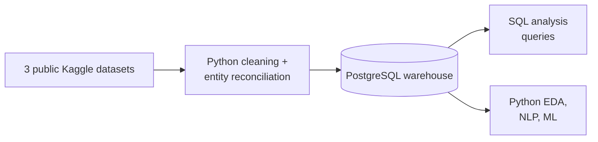

# VoiceIQ — Voice of Customer Analytics Platform


A Qualtrics-inspired Customer Experience & Feedback Intelligence platform for
a B2B SaaS company: NPS/CSAT surveys, support tickets, and product feedback
consolidated into a PostgreSQL warehouse and analyzed with SQL + Python.

## Business problem

Leadership needs one place to answer: why are customers dissatisfied, which
issues drive the most complaints, what drives high NPS, which segments are
at churn risk, and how is sentiment trending. This project builds that
analytics layer end to end — warehouse, SQL analytics, EDA, sentiment/topic
NLP, and a predictive model.

## Architecture



Full lineage, dataset sources, and every derived/modeled field are
documented in [`docs/architecture.md`](docs/architecture.md) — nothing is
silently fabricated; where a public dataset can't provide something (NPS
microdata, usable ticket timestamps), that's called out explicitly.

## Data model

`customers` (1) → `surveys`, `feedback`, `support_tickets` (many). Full
schema: [`sql/01_schema.sql`](sql/01_schema.sql). Field-by-field reference:
[`docs/data_dictionary.md`](docs/data_dictionary.md).

## Tech stack

PostgreSQL · SQL (JOINs, GROUP BY, CASE, HAVING, CTEs) · Python
(Pandas, NumPy, Matplotlib, Scikit-learn, NLTK)

## KPIs

NPS, Relationship & Transactional CSAT, Churn Rate, Resolution Time, SLA
Attainment, Sentiment Score, At-Risk Tier — defined in
[`docs/kpi_definitions.md`](docs/kpi_definitions.md).

## Methodology

| Module | What | Where |
|---|---|---|
| 1 | Dataset selection & architecture | [`docs/architecture.md`](docs/architecture.md) |
| 2 | PostgreSQL schema | [`sql/01_schema.sql`](sql/01_schema.sql) |
| 3 | Data loading & entity reconciliation | [`notebooks/01_data_cleaning.ipynb`](notebooks/01_data_cleaning.ipynb) |
| 4 | SQL analysis queries | [`sql/03_kpis.sql`](sql/03_kpis.sql), [`sql/04_customer_experience.sql`](sql/04_customer_experience.sql) |
| 5 | Python EDA | [`notebooks/03_customer_insights.ipynb`](notebooks/03_customer_insights.ipynb) |
| 6 | Sentiment analysis + complaint topics | [`notebooks/02_sentiment_analysis.ipynb`](notebooks/02_sentiment_analysis.ipynb) |
| 7 | Predictive model (logistic regression) | `notebooks/03_customer_insights.ipynb` (section 6) |

## SQL highlights

Generated columns that compute themselves (`sql/01_schema.sql`):
```sql
nps_category VARCHAR(10) GENERATED ALWAYS AS (
    CASE WHEN nps_score >= 9 THEN 'Promoter'
         WHEN nps_score >= 7 THEN 'Passive'
         ELSE 'Detractor' END
) STORED
```

NPS = % Promoters − % Detractors, with `CASE` (`sql/03_kpis.sql`):
```sql
ROUND(100.0 * (SUM(CASE WHEN nps_category = 'Promoter'  THEN 1 ELSE 0 END)
             - SUM(CASE WHEN nps_category = 'Detractor' THEN 1 ELSE 0 END)) / COUNT(*), 1) AS nps
```

At-risk tiers with CTEs + `CASE` (`sql/04_customer_experience.sql`, query 7):
```sql
CASE
    WHEN ls.nps_score <= 6 AND COALESCE(rt.high_severity_tickets, 0) >= 1 THEN 'High Risk'
    WHEN ls.nps_score <= 6 OR  COALESCE(rt.high_severity_tickets, 0) >= 2 THEN 'Medium Risk'
    WHEN ls.nps_score <= 8 THEN 'Watch'
    ELSE 'Healthy'
END AS risk_tier
```

## Business insights & recommendations

Full report: [`docs/business_report.md`](docs/business_report.md). Headline:
NPS fell from about 38 to 20 over two years while feedback sentiment stayed
flat — the decline traces to support (Critical/High tickets, slow resolution)
and to Starter-plan customers, not to how people talk about the product.
114 active customers are High Risk today (`sql/04_customer_experience.sql`,
query 7), a ready-to-use retention call list.

## Local setup

Raw datasets aren't committed (size + licensing) — see `docs/architecture.md`
§2 for the three public Kaggle sources and where to place them under
`data/raw/`. Requires a Python virtual environment and PostgreSQL 14+.
